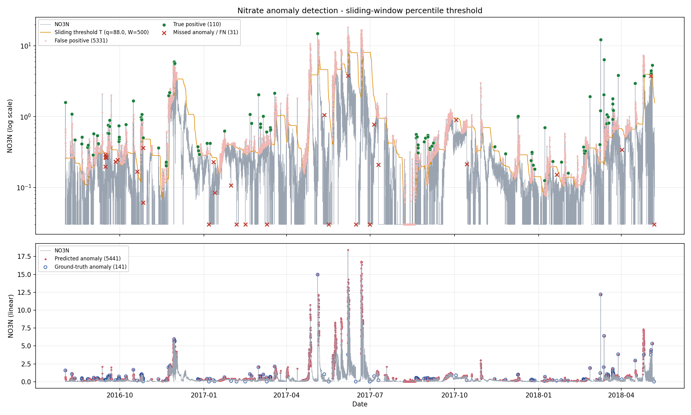
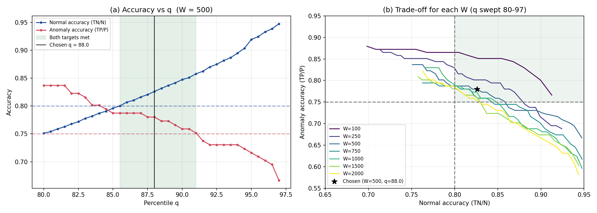

# Nitrate Anomaly Detection — Sliding-Window Percentile Thresholding

Threshold-based anomaly detection on the Nitrate (`NO3N`) time series in
`AG_NO3_fill_cells_remove_NAN.csv`, using fixed-size, overlapping sliding windows
(step = 1) and an adaptive q-percentile threshold. No supervised models are used;
the ground-truth column `Student_Flag` (141 anomalies) is used **only** for evaluation.

## Results (W = 500, q = 88)

| | Predicted anomaly | Predicted normal |
|---|---|---|
| **Actual anomaly** (P = 141) | TP = **110** | FN = **31** |
| **Actual normal** (N = 30,649) | FP = **5,331** | TN = **25,318** |

| Metric | Formula | Value | Target |
|---|---|---|---|
| Normal event detection accuracy | TN / N | **82.61 %** | ≥ 80 % ✅ |
| Anomaly event detection accuracy | TP / P | **78.01 %** | ≥ 75 % ✅ |



*Top (log scale): NO3N series, the adaptive threshold Tᵢ (orange), true positives (green),
missed anomalies (red ×) and false positives (pink). Bottom (linear scale): all predicted
anomalies (red) vs. the 141 ground-truth anomalies (blue circles).*

## Method

1. **Load** `NO3N` (Nitrate) and `Student_Flag` (ground truth) from the CSV.
2. **Windowing** — fixed window size W, step = 1, overlapping:
   window 1 = `[0, W−1]`, window 2 = `[1, W]`, …, window *i* = `[i−1, i+W−2]`.
3. **Threshold** for each window, computed only from the values inside that window:
   ```python
   T_i = np.percentile(x[i-1 : i-1+W], q, method="linear")
   ```
4. **Labeling**
   * **Window 1:** all W points in the first window are labeled with T₁.
   * **Window 2 onward:** only the **newly added point** (index `i+W−2`) is labeled with Tᵢ.
   * Rule (**one-sided, upper tail**): `anomaly if x ≥ Tᵢ`, otherwise normal.
5. **Evaluate** predictions against `Student_Flag` → TP, FP, FN, TN, normal and anomaly accuracy.

Because each Tᵢ uses only the current window (the new point plus the W−1 points
before it), there is **no leakage** of future values.

## Choice of W and q



A sweep over W ∈ {100, 250, 500, 750, 1000, 1500, 2000} and q ∈ [80, 97] (step 0.5)
is saved in `outputs/sensitivity_sweep.csv`.

**Window size W = 500 (≈ 10.4 days of 30-min readings).**
* Panel (b) shows smaller windows dominate: the W = 500 curve sits above W = 750–2000
  for every q. Nitrate has strong seasonal/storm-driven level shifts; a shorter window
  lets the threshold re-adapt to a new baseline quickly, while long windows (1500–2000)
  carry old high/low regimes forward and either miss anomalies or flag whole periods.
* 500 is the smallest value in the suggested 500–2000 range, while still long enough
  (10 days, several hundred samples) to give a stable 88th-percentile estimate that
  isn't pulled around by a single spike. (W = 100–250 score even higher, but were
  kept out of the final choice to stay within the recommended range and avoid an
  overly jumpy threshold.)

**Percentile q = 88.**
* Panel (a): raising q increases normal accuracy and lowers anomaly accuracy.
  With W = 500 both targets are met for **q ∈ [85.5, 91.0]**.
* q = 88 sits in the middle of that feasible band, giving margin on both targets
  (+2.6 pts on normal accuracy, +3.0 pts on anomaly accuracy), so the result is not
  a knife-edge fit to one exact q.

## Design choices

* **One-sided (upper-tail) threshold.** Most labeled anomalies are spikes above the local
  level, and the assignment recommends the upper tail. No lower threshold is used.
* **First window labeled in full** using T₁ (the option described in the assignment).
* **Ties:** `x ≥ Tᵢ` (inclusive), as in the assignment.
* **NaNs:** the provided cleaned file has no missing values (30,790 rows); the script
  still calls `dropna` on `NO3N` as a safeguard. No other filtering or transformation.
* **Implementation check:** the main detector is an explicit loop over windows
  (`sliding_window_detect`). A vectorised version (`sliding_window_detect_fast`, using
  `sliding_window_view` + `np.percentile(..., axis=1, method="linear")`) is used for the
  W/q sweep, and the script asserts both give identical predictions.

### Limitations
* 9 of the 31 missed anomalies sit at the sensor floor (0.03), i.e. they are *low*
  anomalies that an upper-tail rule can't catch by design; a two-sided rule would be
  needed for those, at the cost of more false positives.
* Sustained high-level episodes (e.g., May–July 2017) produce runs of false positives
  while the threshold catches up to the new level.

## How to run

```bash
pip install -r requirements.txt
python anomaly_detection.py                 # W=500, q=88 (default, ~1 min)
python anomaly_detection.py --W 750 --q 85  # other settings
python anomaly_detection.py --no-sweep      # skip the sensitivity sweep
```

## Repository contents

| File | Description |
|---|---|
| `anomaly_detection.py` | Loads CSV, runs sliding-window thresholding, outputs predictions, metrics and plots |
| `AG_NO3_fill_cells_remove_NAN.csv` | Input data (Date, NO3N, Student_Flag) |
| `outputs/predictions.csv` | Original data + threshold used + `Predicted_Anomaly` (0/1) |
| `outputs/metrics.json` | TP, FP, FN, TN, P, N, normal and anomaly accuracy |
| `outputs/anomalies_plot.png` | Time series with detected anomalies highlighted |
| `outputs/sensitivity_W_q.png` | Accuracy vs. q, and trade-off curves for each W |
| `outputs/sensitivity_sweep.csv` | Full W × q sweep results |
| `requirements.txt` | Python dependencies |
